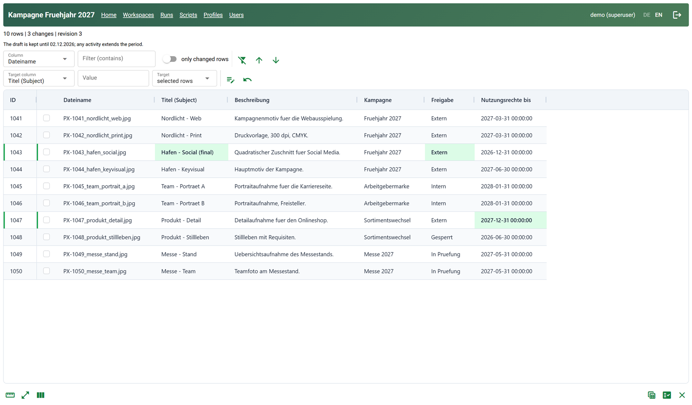
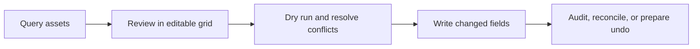
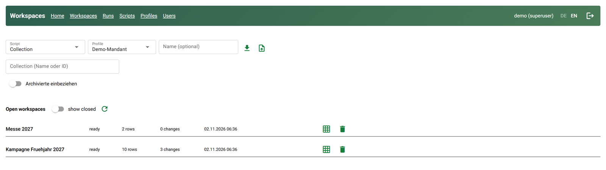
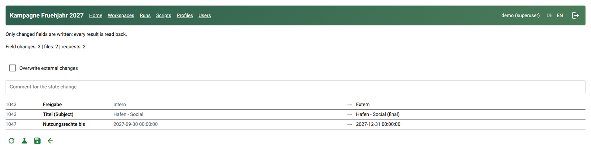
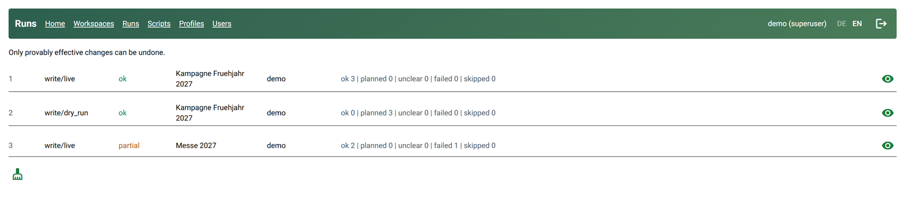
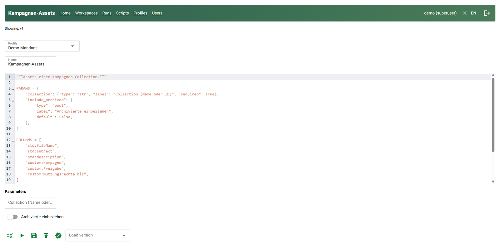

# pixxio_bulkedit

**Safely review and bulk-edit pixx.io asset metadata in a self-hosted web app.**

Load assets selected by a query, edit their metadata in a spreadsheet-style grid, review
the proposed changes, and write only the fields you explicitly changed.





`pixxio_bulkedit` is an independent project and is not affiliated with pixx.io.

## What it does

- **Build asset workspaces** from published Python query scripts, including collections,
  directories, and file-ID lists.
- **Edit metadata in a grid** with filters, sorting, column selection, and bulk actions.
  Workspaces are saved so you can leave and resume them later.
- **Review before writing.** A dry run compares the planned changes with current values
  and reports conflicts before you confirm a write.
- **Write only changed fields.** Identical payloads are grouped into requests; write
  results are read back and recorded.
- **Track and recover.** Runs and field-level changes are audited; you can reconcile
  uncertain results or prepare an inverse change through the same review workflow.
- **Work with Excel.** Export workbooks, edit them outside the app, and import changes
  through a three-way comparison and the existing review/write pipeline.
- **Manage access and credentials.** User roles control access; pixx.io API keys are
  encrypted in the database.

### Scope

This tool edits metadata; it is not an asset uploader or file manager. Asset upload,
deletion, moving, and pixx.io permissions management are out of scope. Some structured
metadata fields are read-only.

## Screenshots

| Load a workspace from a query script | Review every field change before writing |
|---|---|
|  |  |

| Audit runs and prepare undo | Author query scripts in the browser |
|---|---|
|  |  |

The screenshots use synthetic demo data with a fictitious pixx.io account.

## Safety model

Writing to pixx.io is an external side effect. The app is designed to make proposed
changes visible and avoid silently repeating uncertain writes:

1. Review the field-by-field change plan and run a dry run.
2. Resolve or explicitly confirm conflicts caused by external changes.
3. Confirm the write. Only changed fields are sent.
4. Check the recorded results; uncertain runs can be reconciled without resending.

Undo is a **new, reviewed inverse change**, not an atomic rollback. Query scripts run in a
restricted subprocess with time and output limits; script authoring and publishing are
permission-controlled. These controls reduce risk, but they are not a substitute for
testing with a dedicated pixx.io test account and approved test assets.

## Project status

The core query, grid-editing, review/write, audit/undo, and Excel workflows are implemented.
Some production-readiness checks are still outstanding, including live verification of
all supported field types, role checks and restore testing on the target VPS, and
performance measurements on that host. Validate the deployment and your pixx.io API
behavior before using this app for production data.

## Quick start (Windows)

The documented development environment uses CPython 3.14 and the workspace-local
`.venv`. From PowerShell:

```powershell
py -3.14 -m venv .venv
.\.venv\Scripts\python.exe -m pip install -r requirements-dev.lock.txt
.\.venv\Scripts\python.exe -m pip install --upgrade --no-cache-dir --index-url https://pypi.org/simple pixxio-client
Copy-Item .env.example .env
```

Edit `.env` and set the required values:

| Variable | Purpose |
|---|---|
| `BULKEDIT_DB_PATH` | SQLite database path |
| `BULKEDIT_MASTER_KEY` | Fernet key used to encrypt API keys stored in the database |
| `BULKEDIT_STORAGE_SECRET` | Secret used to sign the NiceGUI session (at least 16 characters) |

Generate the two secrets; copy the generated values into `.env` and keep them safe:

```powershell
.\.venv\Scripts\python.exe -m app generate-master-key
.\.venv\Scripts\python.exe -c "import secrets; print(secrets.token_urlsafe(48))"
```

Initialize the database, create the first administrator, and start the app:

```powershell
.\.venv\Scripts\python.exe -m app init-db
.\.venv\Scripts\python.exe -m app create-superuser --username admin
.\.venv\Scripts\python.exe -m app serve
```

Open <http://127.0.0.1:8080>. There is no default password. To connect a pixx.io account,
create a profile with an API key supplied through an environment variable or `.env`—never
as a command-line argument:

```powershell
.\.venv\Scripts\python.exe -m app create-profile --name main --host your-account.px.media --api-key-env PIXIO_API_KEY
```

Replace the example host with your pixx.io host and define `PIXIO_API_KEY` in the
environment or `.env` before running the command. Do not commit `.env`.

## Technology

- Python, NiceGUI, and AG Grid Community
- SQLite, SQLAlchemy, and Alembic migrations
- `pixxio-client` from its current stable PyPI release
- RestrictedPython for query scripts
- XLSX import/export through `openpyxl`

## Development

Direct dependencies are listed in `requirements.txt` and `requirements-dev.txt`.
`requirements-dev.lock.txt` is a Windows/Python 3.14 development snapshot; it is not a
cross-platform lock file. The `pixxio-client` dependency is intentionally kept unpinned.

Run the quality checks from PowerShell:

```powershell
.\.venv\Scripts\python.exe -m pip check
.\.venv\Scripts\python.exe -m ruff check .
.\.venv\Scripts\python.exe -m ruff format --check .
.\.venv\Scripts\python.exe -m pyright
.\.venv\Scripts\python.exe -m pytest -q
```

The automated tests run offline and do not require pixx.io credentials. Live API checks
and performance validation are separate from this test suite.

## Deployment and operations

The repository includes Docker/VPS deployment files, health checks, and manual encrypted
backup and restore scripts. The VPS Compose setup expects an existing Traefik network and
deployment-specific environment values. Review the deployment and backup instructions
before exposing an instance to a network:

- [Dockerfile](Dockerfile)
- [VPS Compose configuration](docker-compose.vps.yml)
- [Deployment script](deploy-vps.sh)
- [Backup script](backup.sh) and [restore script](restore.sh)

## Repository guide

- `app/` — application, CLI, database models, UI, query scripts, and pixx.io integration
- `docs/screenshots/` — UI screenshots used by this README (synthetic demo data)
- `migrations/` — Alembic database migrations
- `tests/` — offline test suite
- `plan/` — product concept and confirmed implementation plan (currently in German)

See [LICENSE](LICENSE) for licensing terms.
